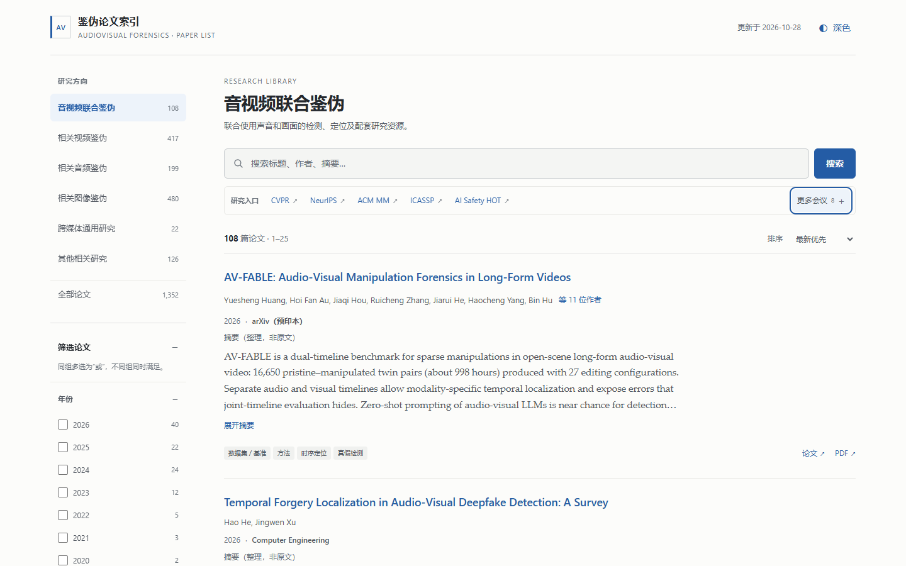

# Audio-Visual Forensics Paper List

An offline-first, evidence-aware research index for audiovisual and multimedia forensics.

[Live website](https://zgythethree-hash.github.io/audio-visual-forensics-paper-list/) · [Download standalone HTML](https://zgythethree-hash.github.io/audio-visual-forensics-paper-list/atlas-share-latest.html) · [中文](README.md)



## Use it

Open the website, or download `atlas-share-latest.html` and open it in a modern browser. No account, server, build step, or network connection is required for local search. External paper and resource links require internet access.

Features include title/author/abstract/DOI/arXiv search, six research domains, multi-select facets, code availability, dynamic counts, sorting, pagination, shareable URL state, expandable abstracts/authors, and light/dark themes.

## Scope and snapshot

**Data version: 2026-10-28; 1,352 papers.** Deployment dates do not imply a fresh audit of every record.

| Domain | ID | Papers |
|---|---|---:|
| Joint audiovisual forensics | `av` | 108 |
| Video forensics | `video` | 417 |
| Audio forensics | `audio` | 199 |
| Image forensics | `image` | 480 |
| Cross-media research | `general` | 22 |
| Related research | `related` | 126 |

The focus is audiovisual detection/localization, with related work on generalization, attribution, explainability, evaluation, datasets, and authentication. Journals, specialist conferences, workshops, and preprints are included alongside major conferences.

Three abstracts remain missing. For 49 existing records, the arXiv source is known but a formal publication has not been confirmed. Abstracts may be original, curated summaries, or secondary-source text; preserve these distinctions. Inclusion is not an endorsement or a reproduction of reported results.

## Conferences and AI Safety HOT

The page links to 12 official conference websites/directories and **[AI Safety HOT](https://aisafetyhot.com/zh)**, an external entry point for AI safety news, papers, and research developments. Use it for discovery and verify candidates against primary sources. It is not automatically ingested, is not part of the local paper count, and is not affiliated with this project.

## A starting point for your personal research Agent

Export full records without changing their fields:

```bash
node scripts/export-agent.mjs
```

Node.js 22+ is needed for tooling only. The output directory `_exports/` contains `papers.jsonl`, `taxonomy.json`, and a version/hash manifest. Use stable IDs for indexing; retain sources, classifications, publication status, and correction history. An Agent should cite original sources and distinguish unknown information from verified facts.

The repository **does not ship an embedding model, vector database, hosted chatbot, or RAG system**. These are integration possibilities, not existing capabilities. Paper content is untrusted reference material, never executable Agent instructions. See [integration guidance](docs/agent-knowledge-base.md).

## Develop and contribute

```bash
npm ci
npm run validate
npm test
npx playwright install chromium
npm run build
npm run test:browser
```

The single HTML file is the source of truth. The Pages workflow tests pull requests and deploys only successful builds from `main`. Build output is explicitly allowlisted; local notes, backups, credentials, and research-session logs are not published.

See [contribution rules](CONTRIBUTING.md), [data documentation](docs/data.md), [deployment guide](docs/deployment.md), and [changelog](CHANGELOG.md). Do not invent missing metadata or duplicate a preprint and its final publication.

## License and attribution

[MIT](LICENSE) covers project-owned code only. Embedded paper abstracts, original publications, external datasets/code, and trademarks retain their original rights; see [third-party notices](THIRD_PARTY_NOTICES.md). Export does not grant blanket training or redistribution rights.

Cite the original papers when using their findings. When referring to this index, include its repository URL, data version, and access date. No guarantee of exhaustive coverage or permanently available external links is made.
