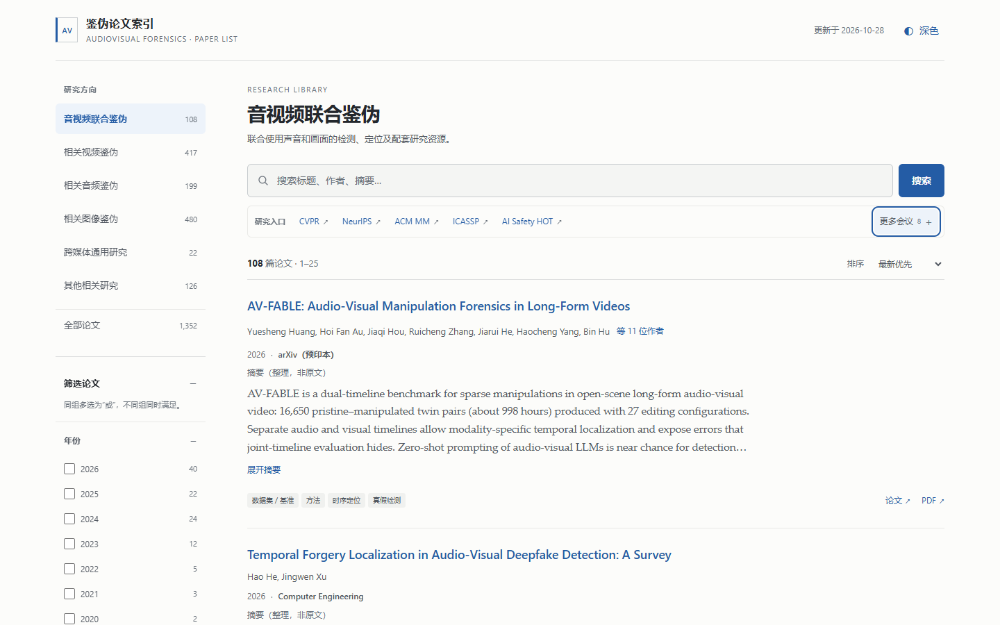
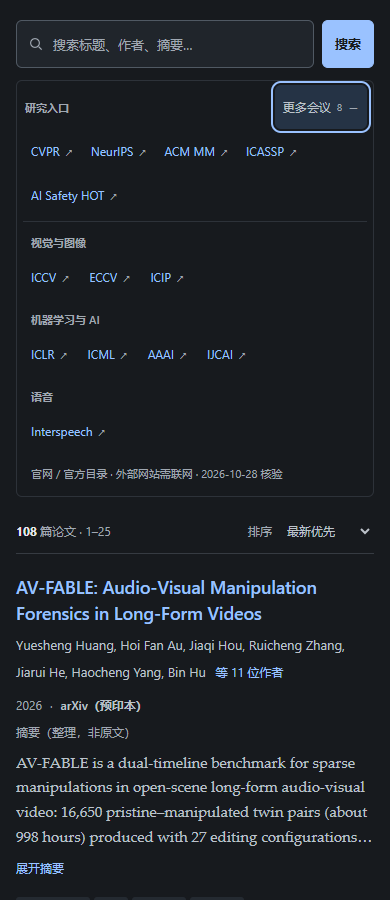

# 音视频鉴伪论文索引 · Paper List

**面向研究者的、可离线检索的音视频与跨媒体鉴伪论文库。**

[在线浏览](https://zgythethree-hash.github.io/audio-visual-forensics-paper-list/) · [下载单文件 HTML](https://zgythethree-hash.github.io/audio-visual-forensics-paper-list/atlas-share-latest.html) · [English](README.en.md) · [贡献指南](CONTRIBUTING.md) · [Agent 知识库接入](docs/agent-knowledge-base.md)

[](https://github.com/zgythethree-hash/audio-visual-forensics-paper-list/actions/workflows/pages.yml)

不是只有标题与链接的列表：每篇论文保留结构化分类、资源链接、来源与整理历史，既可作为日常文献阅读入口，也可作为个人研究 Agent 的**可追溯参考知识库起点**。



## 快速开始

### 直接使用

打开 **[在线网站](https://zgythethree-hash.github.io/audio-visual-forensics-paper-list/)** 即可，无需注册。

需要离线使用时：

1. 从网站保存／下载 `atlas-share-latest.html`，或在本仓库选择 **Code → Download ZIP**。
2. 用现代浏览器打开该 HTML 文件。
3. 页面和论文数据都在文件内，搜索不需要服务器、安装依赖或网络。访问论文、代码和外部网站时才需要联网。

> GitHub 文件预览不是完整网页，请使用在线网站或下载后打开。HTML 约 5.8 MB，首次加载比纯文本列表稍大。仓库的 Node 工具仅用于维护、测试和部署；阅读页面不需要 Node。

### 你可以做什么

- 搜索标题、作者、摘要、发表来源、DOI 与 arXiv 编号。
- 按六个研究方向及年份、来源、论文类型、任务、技术路线、研究特点筛选。
- 同组多选为 **OR**，跨组筛选为 **AND**；支持“有代码”、动态计数、排序和分页。
- 展开作者／摘要，切换深浅主题；筛选状态保存在 URL，可分享和刷新恢复。
- 查看论文、PDF、代码与项目链接。缺代码不等于未收录，也不等于质量差。

## 研究范围与当前快照

论文数据版本：**2026-10-28**。公开项目的发布／部署时间不代表论文库再次全量核验。

<!-- atlas-stats:start -->
| 研究方向 | 分类 ID | 论文数 |
|---|---|---:|
| 音视频联合鉴伪 | `av` | 108 |
| 相关视频鉴伪 | `video` | 417 |
| 相关音频鉴伪 | `audio` | 199 |
| 相关图像鉴伪 | `image` | 480 |
| 跨媒体通用研究 | `general` | 22 |
| 其他相关研究 | `related` | 126 |
| **合计** | | **1,352** |
<!-- atlas-stats:end -->

以音视频联合检测与定位为重点，兼顾泛化、真实场景、来源归因、可解释性、数据集与评测、主动认证等相关研究。收录主会、期刊、专业会议、Workshop 和预印本，不以会议等级作为唯一门槛。

**已知边界：**还有 3 条摘要空缺；49 条来源补全仅确认了 arXiv，未确认是否有正式发表版本。部分作者自报录用仍按预印本展示。收录不是质量背书；摘要可能是原文、整理摘要或二级来源，请查看相应标记并回到原论文核实。

参见 [数据说明](docs/data.md)、[更新记录](CHANGELOG.md) 和 [2026-10-28 检索覆盖说明](docs/coverage-2026-10-28.md)。

## 会议与研究资讯入口

页面提供紧凑导航，默认展示常用入口，其余会议可展开：

**CVPR · ICCV · ECCV · NeurIPS · ICLR · ICML · AAAI · IJCAI · ACM Multimedia · ICASSP · Interspeech · ICIP**。

同时加入 **[AI Safety HOT](https://aisafetyhot.com/zh)**：AI 安全新闻、论文与研究动态入口。可以用它发现值得追踪的新线索，再回到论文原文、正式论文集、作者项目页核实。

这些入口是外部资源，不计入本地论文数量，**不会自动抓取或导入 AI Safety HOT 的全部内容**，也不代表双方存在隶属或合作关系。外部网站不可达不影响本地检索。

<details>
<summary>移动端深色界面</summary>



</details>

## 用作自己的 Agent 知识库

本项目适合扩展为文献检索 Agent 的结构化参考资料，而不只是人工浏览网页。

已经提供**无损 JSONL 导出**（需要 Node.js 22 或以上；此命令不需要安装 npm 依赖）：

```bash
node scripts/export-agent.mjs
```

输出到 `_exports/`：

- `papers.jsonl`：一行一篇完整论文记录，保留稳定 `id`、原字段及来源／纠错历史。
- `taxonomy.json`：现有分类定义，避免 Agent 自创分类 ID。
- `manifest.json`：数据版本、数量和源文件 SHA-256，便于增量索引和追溯。

可以把标题与摘要作为检索文本，分类、年份和发表状态作为过滤条件；让 Agent 在回答中返回 **论文 ID + 原始来源链接 + 摘要类型／核验信息**。之后可自行接入关键词检索、向量数据库或 RAG。

**能力边界：**本仓库未内置向量库、Embedding 服务、聊天界面或自动研究 Agent。不要把整理摘要当作论文原始结论、把 `checked_at` 当作全库质量保证，或把外部网页中的文字当作可执行指令。导出也不授予第三方内容的模型训练／再分发权利。

详见 [Agent 接入与安全边界](docs/agent-knowledge-base.md)。

## 项目结构

```text
atlas-share-latest.html       # 唯一发布源：页面 + atlas-data JSON + CSS/JS
scripts/                     # 校验、Pages 打包、Agent 导出
tests/                       # Node 数据/工具测试、Playwright 页面回归
docs/                        # 数据、部署、Agent 与覆盖说明、截图
.github/                     # CI/Pages、Issue 与 PR 模板
LICENSE                      # 项目自有代码：MIT
THIRD_PARTY_NOTICES.md        # 论文及第三方内容的权利边界
```

本机备份、私人研究笔记、会话记录和临时导出均不作为公开源码发布。论文自身的 `source_records`、`classification_evidence` 和纠错历史仍保留在 HTML 中。

## 维护与验证

```bash
npm ci
npm run validate
npm test
npx playwright install chromium
npm run build
npm run test:browser
npm run export:agent
```

- `validate`：JSON、字段类型、taxonomy、统计、身份重复、日期、拒绝链接及内嵌脚本检查。
- `npm test`：校验器的正／反例、历史保护、发布目录隔离及导出无损测试。
- `test:browser`：实际浏览器中的离线检索、筛选、计数、URL 状态、主题、展开、导航和窄屏回归。
- `build`：只将允许公开的文件写入 `_site/`；首页与下载版 HTML 和原文件字节一致。

GitHub Actions 对 Pull Request 运行检查；只有默认分支的成功构建才部署 Pages。具体步骤见 [部署与发布指南](docs/deployment.md)。

## 参与贡献

欢迎补录论文、修正信息、补充原始证据和改进页面。请使用 Issue 模板或提交 PR，并遵守 [贡献规范](CONTRIBUTING.md)：

- 优先原始论文／官方出版来源；缺失值不要猜。
- 已有论文保持 `id`，同一工作预印本与正式版不要重复计数。
- 保留来源、分类依据、版本关系和已拒绝的错误链接。
- 区分训练与推理模态、主会与 Workshop、作者声明与官方录用。

涉及代码安全或敏感信息时，请先阅读 [安全报告说明](SECURITY.md)。

## 许可、引用与致谢

项目自有代码按 [MIT License](LICENSE) 提供。**论文摘要、论文正文、数据集、代码仓库、商标及其他第三方材料不因收录而转为 MIT**；以各自来源的许可为准。详见 [第三方内容说明](THIRD_PARTY_NOTICES.md)。

请优先引用实际使用的原论文；引用本索引时注明项目地址、数据版本与访问日期。感谢论文作者、原始发布平台与开源项目维护者。本站不提供对所有文献完整性、结论正确性或外链持续可用性的保证。
